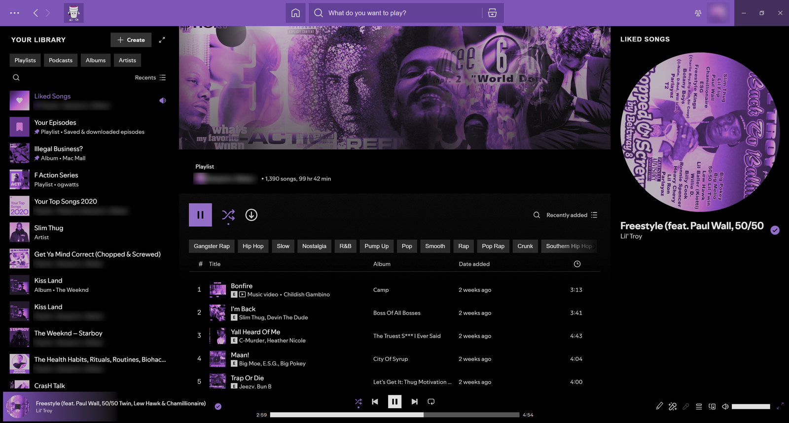

# Biekdafreak - Purple Drank

A black-and-purple [Spicetify](https://spicetify.app) theme: solid black, one purple accent, square edges.



## What you get

- **Black and purple, nothing else.** Solid black background, purple (`#744DA9`) accents, square corners, no shadows, no blur.
- **Purple artwork.** Every album cover and artist photo is tinted purple, so the whole app stays in one colour.
- **Purple top bar** with darker purple buttons, and a purple cup in place of the Marketplace cart.
- **Liked Songs banner.** The Liked Songs page gets a full-width banner made from album covers of the artists you have liked the most songs by.
- **Selectable text.** Song titles and artist names can be highlighted and copied.

It also restyles three popular add-ons if you have them. None of them is required.

| Add-on | What the theme does |
| --- | --- |
| [Spicy Lyrics](https://github.com/Spikerko/spicy-lyrics) | Light purple lyrics page with readable dark buttons, and a plain black Now Playing panel |
| Cover Ambience | The playbar glow is purple instead of being taken from the cover |
| Rounded Thicker Bars (snippet) | Still works: the theme keeps bars flat by default but lets a snippet round them |

For the flat light purple Spicy Lyrics page, set Spicy Lyrics' **Static Background** to **Color**. With it off, you get the animated cover art tinted purple instead.

## Install

### Marketplace (easiest)

1. Open **Marketplace** in Spotify and go to the **Themes** tab.
2. Search for **Purple Drank** and click **Install**.

A Marketplace install picks up new versions on its own. There is nothing to reinstall, though a change can take a day to reach you.

### By hand

You need [Spicetify](https://spicetify.app/docs/getting-started) and [Git](https://git-scm.com/downloads).

**Windows (PowerShell)**

```powershell
$dir = Split-Path (spicetify -c)
git clone https://github.com/Biekdafreak/spicetify-purple-drank "$dir\Themes\Biekdafreak - Purple Drank"
Copy-Item "$dir\Themes\Biekdafreak - Purple Drank\extensions\likedSongsBanner.js" "$dir\Extensions\"
spicetify config current_theme "Biekdafreak - Purple Drank" color_scheme purple extensions likedSongsBanner.js
spicetify apply
```

**macOS / Linux**

```bash
dir="$(dirname "$(spicetify -c)")"
git clone https://github.com/Biekdafreak/spicetify-purple-drank "$dir/Themes/Biekdafreak - Purple Drank"
cp "$dir/Themes/Biekdafreak - Purple Drank/extensions/likedSongsBanner.js" "$dir/Extensions/"
spicetify config current_theme "Biekdafreak - Purple Drank" color_scheme purple extensions likedSongsBanner.js
spicetify apply
```

The banner script is optional. Without it, the Liked Songs page keeps Spotify's own header.

### Updating a by-hand install

Run `git pull` inside the theme folder, copy `extensions/likedSongsBanner.js` into your `Extensions` folder again, then run `spicetify apply`.

### Uninstall

In Marketplace, open **Installed** and remove the theme. For a by-hand install:

```bash
spicetify config color_scheme ' ' current_theme ' ' extensions likedSongsBanner.js-
spicetify apply
```

Then delete the `Biekdafreak - Purple Drank` folder from `Themes`.

## Make it your own

Every colour the theme uses is named at the top of [`user.css`](user.css), in the block marked **1. Palette**. Change a value there and the whole theme follows:

```css
--pd-purple: #744DA9;   /* the accent: top bar, cards, buttons */
--pd-lavender: #9D7FD1; /* Spicy Lyrics page background */
```

Two things you might want to switch off, both in `user.css`:

- **The purple tint on covers:** delete section **4. Purple-tinted artwork**.
- **Capital-letter headings:** delete the `text-transform: uppercase` line in section **3. Type**.

If you installed from Marketplace you can do the same without touching files: add a snippet under **Marketplace → Snippets → Add CSS**, for example `img { filter: none !important; }` to bring back full-colour covers.

## Something looks wrong?

Spotify renames parts of its interface often, and a theme can lag behind. Please [open an issue](https://github.com/Biekdafreak/spicetify-purple-drank/issues) with a screenshot, your Spotify version and your Spicetify version (`spicetify -v`).

If you like the theme, a star on this repo helps other people find it in Marketplace.

## License

Code (CSS and JavaScript): MIT, see [LICENSE](LICENSE).
The cup artwork (`assets/cart-cup.png`, embedded in `user.css`) is included by permission of its rights holder and is not covered by the MIT license.
