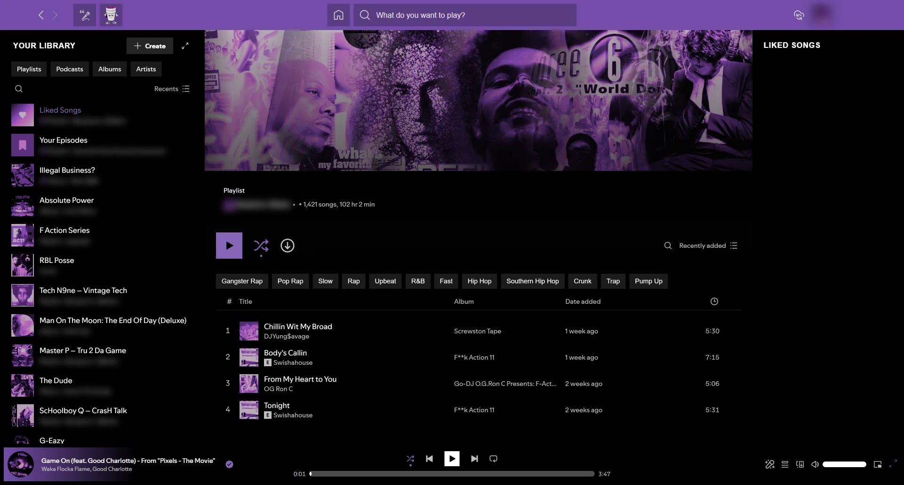
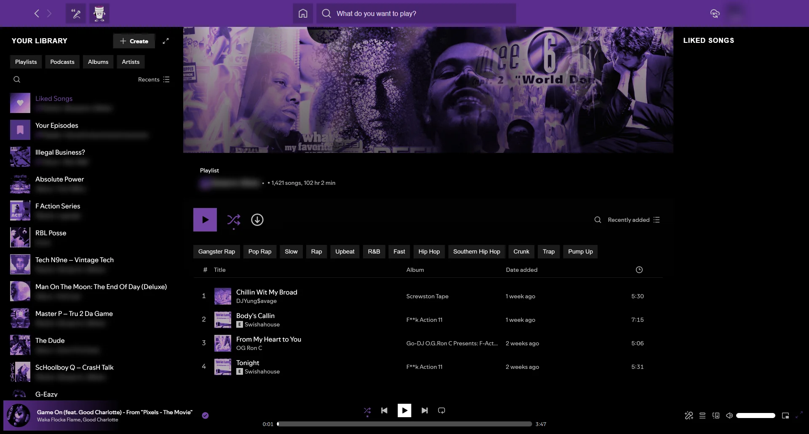
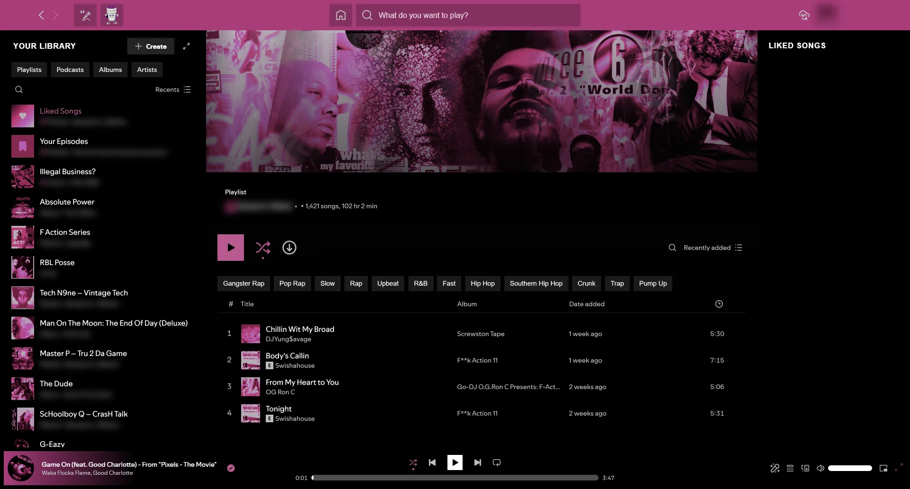
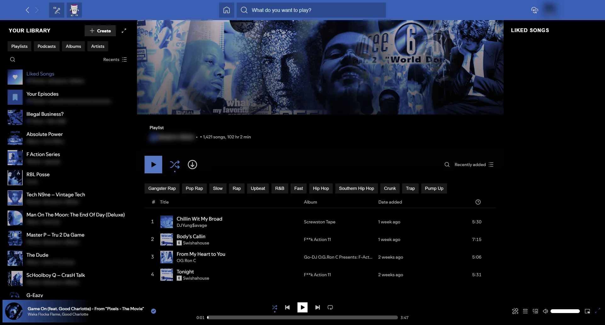
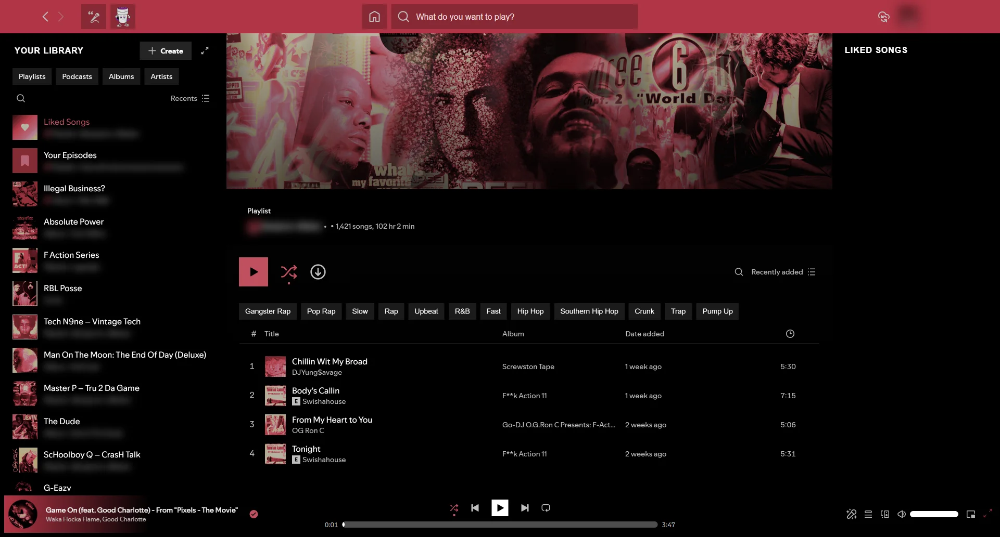
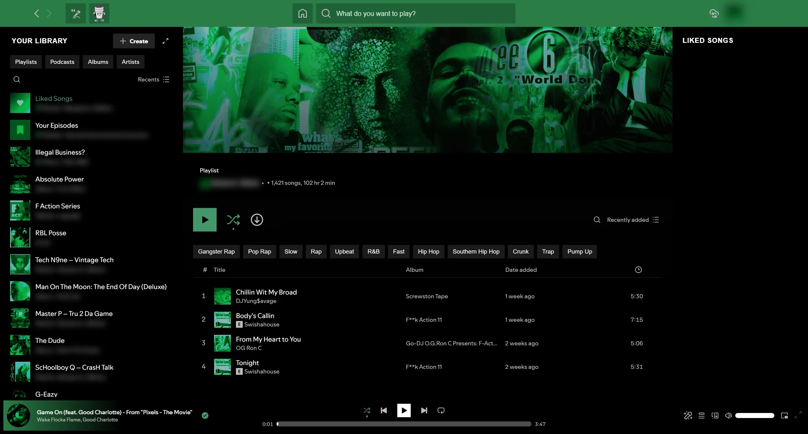

# Biekdafreak - Purple Drank

A [Spicetify](https://spicetify.app) theme: solid black, one accent colour, square edges. Purple by default, with five more colour schemes.


## Colour schemes

| | |
| --- | --- |
| **purple** (default)<br> | **grape**<br> |
| **berry**<br> | **blue-razz**<br> |
| **cherry**<br> | **lime**<br> |

In Marketplace, pick a scheme from the colour drop-down that appears at the top of the Marketplace page once the theme is installed. If you installed the theme before the schemes were added, remove it and install it again to get them.

## What you get

- **Black and one colour, nothing else.** Solid black background, one accent (purple `#744DA9` by default), square corners, no shadows, no blur.
- **Tinted artwork.** Every album cover and artist photo is tinted to the accent, so the whole app stays in one colour.
- **Accent top bar** with darker buttons, and a purple cup in place of the Marketplace cart.
- **Liked Songs banner.** The Liked Songs page gets a full-width banner made from album covers of the artists you have liked the most songs by.
- **Selectable text.** Song titles and artist names can be highlighted and copied.

It also restyles three popular add-ons if you have them. None of them is required.

| Add-on | What the theme does |
| --- | --- |
| [Spicy Lyrics](https://github.com/Spikerko/spicy-lyrics) | Light lyrics page in the accent colour with readable dark buttons, and a plain black Now Playing panel |
| Cover Ambience | The playbar glow is the accent colour instead of being taken from the cover |
| Rounded Thicker Bars (snippet) | Still works: the theme keeps bars flat by default but lets a snippet round them |

For the flat light Spicy Lyrics page, set Spicy Lyrics' **Static Background** to **Color**. With it off, you get the animated cover art tinted to the accent instead.

## Install

### Marketplace (easiest)

1. Open **Marketplace** in Spotify and go to the **Themes** tab.
2. Search for **Purple Drank** and click **Install**.

A Marketplace install picks up new versions on its own. There is nothing to reinstall, though a change can take a day to reach you.

### By hand

You need [Spicetify](https://spicetify.app/docs/getting-started) and [Git](https://git-scm.com/downloads).

**Windows (PowerShell)**

```powershell
$dir = Split-Path (spicetify -c)
git clone https://github.com/Biekdafreak/spicetify-purple-drank "$dir\Themes\Biekdafreak - Purple Drank"
Copy-Item "$dir\Themes\Biekdafreak - Purple Drank\extensions\*.js" "$dir\Extensions\"
spicetify config current_theme "Biekdafreak - Purple Drank" color_scheme purple
spicetify config extensions likedSongsBanner.js
spicetify config extensions purpleDrankTint.js
spicetify apply
```

**macOS / Linux**

```bash
dir="$(dirname "$(spicetify -c)")"
git clone https://github.com/Biekdafreak/spicetify-purple-drank "$dir/Themes/Biekdafreak - Purple Drank"
cp "$dir/Themes/Biekdafreak - Purple Drank/extensions/"*.js "$dir/Extensions/"
spicetify config current_theme "Biekdafreak - Purple Drank" color_scheme purple
spicetify config extensions likedSongsBanner.js
spicetify config extensions purpleDrankTint.js
spicetify apply
```

For another scheme, put its name in place of `purple`: `grape`, `berry`, `blue-razz`, `cherry` or `lime`.

Both scripts are optional. Without `likedSongsBanner.js` the Liked Songs page keeps Spotify's own header. Without `purpleDrankTint.js` the covers stay purple whichever scheme you pick.

### Updating a by-hand install

Run `git pull` inside the theme folder, copy the files in `extensions` into your `Extensions` folder again, then run `spicetify apply`.

### Uninstall

In Marketplace, open **Installed** and remove the theme. For a by-hand install:

```bash
spicetify config color_scheme ' ' current_theme ' '
spicetify config extensions likedSongsBanner.js-
spicetify config extensions purpleDrankTint.js-
spicetify apply
```

Then delete the `Biekdafreak - Purple Drank` folder from `Themes`.

## Make it your own

The whole theme is worked out from one accent colour, so your own scheme is a few lines. In [`color.ini`](color.ini), copy any block, give it a new name and change the accent (`button`, and the keys that repeat it) and its lighter shade (`button-active`):

```ini
[my-scheme]
button        = C2571A
button-active = D2733F
```

Then select it with `spicetify config color_scheme my-scheme` and `spicetify apply`. The darker and lighter shades the theme needs, and the tint on the covers, follow on their own.

Two things you might want to switch off, both in `user.css`:

- **The tint on covers:** delete section **4. Tinted artwork**.
- **Capital-letter headings:** delete the `text-transform: uppercase` line in section **3. Type**.

If you installed from Marketplace you can do the same without touching files: add a snippet under **Marketplace → Snippets → Add CSS**, for example `img { filter: none !important; }` to bring back full-colour covers.

## Something looks wrong?

Spotify renames parts of its interface often, and a theme can lag behind. Please [open an issue](https://github.com/Biekdafreak/spicetify-purple-drank/issues) with a screenshot, your Spotify version and your Spicetify version (`spicetify -v`).

If you like the theme, a star on this repo helps other people find it in Marketplace.

## License

Code (CSS and JavaScript): MIT, see [LICENSE](LICENSE).
The cup artwork (`assets/cart-cup.png`, embedded in `user.css`) is included by permission of its rights holder and is not covered by the MIT license.
